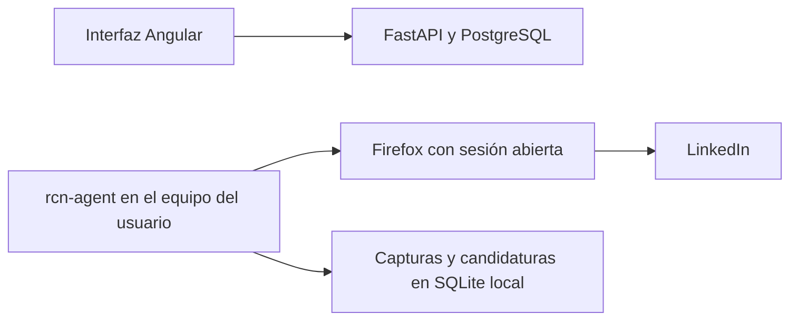

# RNC: copiloto de carrera con agente local

## Dirección del producto

RNC acompaña el ciclo perfil → vacante → preparación → postulación → seguimiento.
LinkedIn es el primer adaptador de navegador. El perfil del candidato y su historial
de candidaturas pertenecen a RNC; el adaptador traduce acciones concretas al DOM.

Se reutiliza el patrón de `../learnex-exporter/src/capture/browser.py`: Firefox abierto,
inicio de sesión manual, Selenium con `--connect-existing` y Marionette local. El código
de RNC es independiente; no importa módulos ni datos de Learnex.



La API central y el agente local todavía no están conectados. El agente funciona hoy
desde la terminal y puede ser invocado por herramientas de desarrollo. Un servidor
MCP y la integración con Angular son entregas futuras.

## Lo implementado

| Comando | Resultado |
| --- | --- |
| `doctor` | Diagnóstico de Firefox, geckodriver y puerto Marionette. |
| `capture-profile` | Captura nombre, titular y secciones renderizadas; desplaza la página para cargar secciones inferiores. |
| `inspect-profile` | Diagnóstico de encabezados, párrafos de la tarjeta superior y campos detectados, sin guardarlo. |
| `capture-job` | Captura título, empresa, ubicación, descripción y presencia de Easy Apply. |
| `inspect-job` | Diagnóstico de encabezados, botones y diálogos de la vacante, sin guardar una captura. |
| `inspect-application` | Describe campos, etiquetas, opciones y acciones del paso visible. |
| `inspect-application --open` | Hace clic en el botón Easy Apply y luego inspecciona el diálogo. |
| `track` | Registra explícitamente el estado de una candidatura ya capturada. |
| `applications` | Lista candidaturas locales, con filtro por estado. |

Las capturas incluyen URL canónica y fecha. Se conserva cada captura; las candidaturas
se deduplican por URL de vacante y mantienen un historial de cambios de estado. El
estado `applied` se registra únicamente con una instrucción explícita `track` del usuario;
capturar una vacante o inspeccionar un formulario nunca lo marca como enviado.

El perfil capturado es el perfil que indiques o tengas abierto. Esta entrega no verifica
que sea tu propio perfil, no genera contenido con IA, no edita LinkedIn y no rellena ni
envía formularios. La inspección de Easy Apply cubre únicamente el paso visible, no los
pasos siguientes ni formularios externos.

## Preparación en Ubuntu/Linux

```bash
cd /home/marc/Documentos/Proyects/RNC/backend
uv venv .venv
uv pip install --python .venv/bin/python -e '.[browser,dev]'
```

Se usa Selenium como dependencia opcional: la imagen Docker del backend no necesita
Firefox ni esta dependencia. Se puede ejecutar el módulo sin instalar el comando:

```bash
.venv/bin/python -m app.local_agent.cli --help
```

1. Cierra Firefox completamente cuando puedas hacerlo sin interrumpir tu trabajo.
2. Ábrelo con `firefox --marionette`.
3. En ese Firefox inicia sesión y abre tu perfil o una vacante de LinkedIn.
4. Ejecuta `.venv/bin/rcn-agent doctor` y revisa `ready`.

Ejecutar `firefox --marionette` mientras Firefox ya está abierto puede reutilizar la
instancia sin habilitar Marionette. El agente no cierra ni reinicia tu Firefox.
Con Firefox Snap usa su geckodriver (`/snap/bin/geckodriver`); el agente lo encuentra
en PATH o en esa ruta. Marionette debe escuchar en `127.0.0.1:2828`.

La exclusión entre procesos usa `flock`; esta primera versión está orientada a Linux.
Ejecuta un solo controlador de Marionette a la vez: termina el comando de Learnex
antes de conectar RNC al mismo Firefox.

## Flujo de uso

Desde `backend/`:

```bash
# Diagnóstico sin controlar pestañas ni capturar datos de la cuenta.
.venv/bin/rcn-agent doctor

# Leer el perfil abierto; --url permite elegir uno explícitamente.
.venv/bin/rcn-agent capture-profile
.venv/bin/rcn-agent capture-profile --url https://www.linkedin.com/in/tu-perfil/

# Opcional: leer únicamente lo ya renderizado, sin desplazamiento.
.venv/bin/rcn-agent capture-profile --no-scroll

# Si no se reconoce el perfil, obtener pistas de su estructura.
.venv/bin/rcn-agent inspect-profile --url https://www.linkedin.com/in/tu-perfil/

# Capturar una vacante para trabajarla localmente.
.venv/bin/rcn-agent capture-job --url https://www.linkedin.com/jobs/view/123456789/

# También acepta la oferta seleccionada dentro de los resultados de búsqueda.
.venv/bin/rcn-agent capture-job \
  --url 'https://www.linkedin.com/jobs/search-results/?currentJobId=123456789'

# Diagnóstico si la oferta usa una estructura no reconocida.
.venv/bin/rcn-agent inspect-job

# Guardarla en el seguimiento.
.venv/bin/rcn-agent track --job-url https://www.linkedin.com/jobs/view/123456789/ \
  --status saved --notes 'Revisar idioma y disponibilidad para LATAM'

# Abrir Easy Apply e inspeccionar las preguntas del paso actual.
.venv/bin/rcn-agent inspect-application \
  --url https://www.linkedin.com/jobs/view/123456789/ --open

# Después de completar y enviar tú la candidatura en Firefox:
.venv/bin/rcn-agent track --job-url https://www.linkedin.com/jobs/view/123456789/ \
  --status applied --notes 'Enviado desde Firefox'

.venv/bin/rcn-agent applications
.venv/bin/rcn-agent applications --status applied
```

Estados: `saved`, `preparing`, `applied`, `interview`, `offer`, `rejected`, `withdrawn`.
El seguimiento permite registrar cambios manuales; no impone una secuencia de estados.
Omitir `--notes` conserva las notas anteriores; `--notes ''` las limpia.

Los comandos devuelven JSON por stdout y errores por stderr con código de salida 1.
Si hay un error de conexión, `doctor` permite distinguir falta de geckodriver y puerto
cerrado. `doctor` devuelve código 0 cuando puede completar el diagnóstico, aunque
`ready` sea `false`.

El agente usa una pestaña existente que coincida con el recurso. Cuando indicas
`--url` y no está abierta, navega una pestaña de LinkedIn existente a esa URL; no
navega otras páginas. Puedes abrir una pestaña dedicada para RNC. Al terminar deja
la pestaña en su estado actual, incluido cualquier diálogo que haya abierto.
Se admiten `/jobs/search/` y `/jobs/search-results/` con un único `currentJobId`
numérico. El agente abre la URL directa `/jobs/view/ID/` en esa pestaña para trabajar
solo con la oferta seleccionada. Los parámetros de seguimiento no se almacenan.
Si los resultados tienen un diálogo abierto, el agente conserva esa página y pide
abrir la URL directa en otra pestaña. No navega dejando un formulario abierto atrás.

`inspect-job` describe hasta 30 encabezados y botones, los selectores de descripción
presentes, los nombres de hasta cinco enlaces de empresa y los encabezados/clases
de diálogos visibles con su número de campos. También incluye el título de la pestaña,
hasta 15 párrafos de la cabecera con tamaño de fuente, las fuentes de extracción y
las etiquetas/tipos de campos y acciones de diálogos visibles. No incluye el texto de
la descripción, valores de formularios ni HTML completo. Sirve para ajustar el lector a la estructura
que LinkedIn muestre en ese equipo.

La captura de ofertas espera hasta 15 segundos a que carguen título y descripción.
Además de los selectores antiguos, lee descripciones por los encabezados «About the
job»/«Acerca del empleo» y sus variantes. Para el título puede usar un enlace a la misma
vacante, un título de pestaña específico de oferta o un párrafo destacado en la cabecera.
`field_sources` informa qué alternativa se usó; un encabezado de sección como «Use AI
to assess how you fit» no se considera título de la oferta.

Easy Apply se reconoce tanto por los marcadores antiguos como por el nombre accesible,
etiquetas de solicitud o un paso de contacto con campos identificados y botón «Next».
También se admite un diálogo nuevo con campos que aparezca inmediatamente después
de pulsar el único botón Easy Apply de esa oferta. Si ya hay un diálogo abierto que no
se puede identificar, el agente lo conserva y solicita un diagnóstico en lugar de volver
a pulsar el botón. `detection` explica cómo reconoció el formulario.

Si el formulario ya está abierto, se puede leer directamente, sin volver a abrirlo:

```bash
.venv/bin/rcn-agent inspect-application
```

Las etiquetas pueden provenir de `label`, `legend`, `aria-label` o `aria-labelledby`,
incluidas referencias accesibles a textos ocultos. El resultado describe el paso actual;
no rellena respuestas, pulsa «Next» ni envía la solicitud.
Sin `--url`, se prefiere la pestaña actual si es un recurso compatible. La captura
del perfil espera hasta 15 segundos a que aparezca el nombre, incluso después de
que el navegador indique que el documento terminó de cargar. Acepta encabezados
visibles `h1`, encabezados accesibles y variantes de la tarjeta superior con `h2`.
Las secciones se identifican por encabezados en inglés o español (por ejemplo,
`About`/`Acerca de`, `Experience`/`Experiencia`), además de los identificadores antiguos.
Así no depende de las clases generadas ni de que exista un `id="experience"`.
Los contadores de encabezado se reconocen: `Skills (64)` y `Aptitudes (64)` se leen
como secciones de aptitudes. Cada sección se acota a su tarjeta, evitando incorporar
el pie de página cuando todavía no ha cargado la sección siguiente.

La captura desplaza la ventana o el contenedor de perfil hasta 20 veces para cargar
secciones inferiores, y restaura la posición inicial incluso si ocurre un error.
Conserva los campos ya leídos si LinkedIn retira contenido anterior del DOM. No abre
enlaces de detalle ni hace clic en botones de edición o envío. `--no-scroll` desactiva
ese desplazamiento.

`capture_status` indica `partial` si algún campo no se pudo leer o un contador de
sección anuncia más elementos de los que se pueden verificar en la vista principal.
`capture_scope` es `rendered_overview`. `field_status` distingue
`captured` de `not_detected`; un campo no detectado **no implica que esté vacío en
LinkedIn**. `field_sources` indica cómo se leyó cada campo, incluido el uso del primer
párrafo de la tarjeta superior como alternativa para el titular. Revisa ese titular:
la estructura de LinkedIn puede cambiar. Las capturas parciales incluyen una advertencia;
si solo se reconoce el nombre, el comando falla y no guarda una captura nueva.
`section_counts` informa el total anunciado y el número de elementos renderizados
identificables; este último queda en `null` si no se puede verificar. Por ejemplo,
`skills: {"reported": 64, "rendered": 2}` significa que se leyeron dos elementos de una
sección que anuncia 64, no la lista completa. `incomplete_sections` y las advertencias
hacen explícita esa limitación. No se abre automáticamente «Show all»/«Mostrar todo».

`inspect-profile` devuelve los selectores encontrados y hasta 20 encabezados con su
etiqueta, rol, clase y texto acotado, además de identificadores de secciones. También
incluye hasta 12 párrafos de la tarjeta superior y, por campo, presencia, longitud y
fuente de extracción. Puede incluir tu nombre, titular y ubicación; revisa esos datos
antes de compartir la salida. No incluye el HTML completo, mensajes ni valores de
formularios, y no desplaza la página.

## Datos locales y límites operativos

Por defecto el archivo es `~/.local/share/rcn/career.sqlite3`, o `$XDG_DATA_HOME/rcn/`
si esa variable existe. Contiene datos profesionales y notas privadas; directorio
nuevo con permisos 700 y archivo de base con permisos 600.

Puedes elegir otra ruta o puerto pasando las opciones antes del comando:

```bash
.venv/bin/rcn-agent --data-dir ../data/local-agent applications
.venv/bin/rcn-agent --marionette-port 2828 doctor
```

Se exportan campos seleccionados del DOM visible, no cookies, contraseñas, valores
de formularios ni el HTML completo. En perfiles, las secciones contienen el texto
renderizado y pueden incluir encabezados y etiquetas de LinkedIn. Los campos que
no se logren leer quedan vacíos con estado `not_detected`. El desplazamiento es limitado:
`captured` confirma que se leyó contenido de los campos, no que se hayan abierto todos
los elementos de «Ver más» o páginas de detalle. Las secciones se acotan a 8.000 caracteres
(16.000 para experiencia). El agente no abre esas páginas ni expande botones automáticamente.

Si el DOM cambia, una vacante no carga, hay varios botones Easy Apply o aparece un
inicio de sesión/verificación, el comando se detiene. El usuario resuelve la situación
en Firefox y repite. LinkedIn puede restringir la automatización del navegador; usar
tu sesión no elimina esa limitación. Esta entrega no implementa técnicas de evasión.

La conexión reutiliza la sesión mediante los flags documentados por Mozilla:
[geckodriver --connect-existing](https://firefox-source-docs.mozilla.org/testing/geckodriver/Flags.html).
Con ese modo, eliminar la sesión de WebDriver no envía el cierre forzado usado para
un navegador lanzado por geckodriver; se verifica con una reconexión en las pruebas.

## Próximas entregas

1. **Integración con RNC:** asociar capturas al candidato y sincronizar vacantes y
   candidaturas con FastAPI. Definir identidad/autenticación antes de transportar
   datos privados al servicio alojado.
2. **Perfil profesional:** comparar el perfil capturado con la información verificada
   del CV; preparar propuestas de titular, Acerca de y experiencia con vista previa.
3. **Preparación de candidaturas:** correspondencia de preguntas y respuestas
   verificadas, carga del CV, validación de campos y revisión previa al envío.
4. **Interfaz Angular:** panel de conexión, comparación de perfil, bandeja de vacantes
   y seguimiento de candidaturas. El acceso a Firefox seguirá ocurriendo en el equipo
   del usuario, no en el contenedor remoto.
5. **MCP/skill propia:** exponer acciones concretas del agente para asistentes y un
   flujo de trabajo reutilizable. No hace falta adoptar un MCP de terceros para
   implementar el adaptador inicial.

La integración futura puede usar un agente que consulte tareas autenticadas por
HTTPS. Así el servicio central no necesita alcanzar el puerto Marionette del equipo
del usuario ni recibir su perfil de navegador.
